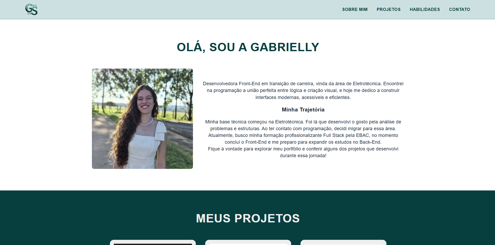

# 💻 Portfólio Pessoal

Portfólio desenvolvido com **React e Vite** para apresentar minha trajetória na área de tecnologia, minhas habilidades técnicas e os projetos que desenvolvi durante minha jornada de aprendizado em desenvolvimento web pela EBAC.

O projeto foi construído de forma organizada, com reutilização de componentes, responsividade e boas práticas de desenvolvimento.

## 🌐 Acesse o projeto

**Deploy:** [Acesse meu portfólio](https://portifolio-gabrielly-gs.vercel.app/)

## 📸 Preview



## 🚀 Tecnologias utilizadas

- **React:** construção da interface utilizando componentes reutilizáveis.
- **Vite:** ferramenta de desenvolvimento e build do projeto.
- **JavaScript:** implementação da lógica e interatividade.
- **CSS Modules:** estilização isolada por componente.
- **React Router DOM:** gerenciamento da navegação entre páginas.
- **Formspree:** integração do formulário de contato para recebimento de mensagens por e-mail.
- **Git e GitHub:** versionamento e armazenamento do código-fonte.
- **Vercel:** hospedagem e publicação do projeto.

## ✨ Funcionalidades

### Página inicial

A página principal apresenta as seguintes seções:

- **Sobre Mim:** apresentação pessoal, trajetória e objetivos profissionais.
- **Projetos:** exibição dos projetos desenvolvidos, com resumos e acesso às informações detalhadas.
- **Habilidades:** apresentação das tecnologias e ferramentas que fazem parte dos meus conhecimentos.
- **Contato:** formulário para que visitantes possam enviar mensagens diretamente para meu e-mail.

### Componentes reutilizáveis

O projeto utiliza componentes independentes para facilitar a manutenção e reutilização de elementos da interface.

### Formulário de contato

O formulário utiliza o serviço **Formspree** para receber e encaminhar mensagens por e-mail, sem a necessidade de desenvolver um backend próprio.

A integração utiliza:

- `fetch` para realizar a requisição HTTP.
- `async/await` para trabalhar com operações assíncronas.
- `FormData` para coletar os dados do formulário.
- `try/catch` para tratamento de erros.
- Estados do React para controlar o envio, sucesso e falha da operação.
- Validação dos campos obrigatórios e do formato do e-mail.

Durante o envio, o botão é desabilitado para evitar submissões repetidas. Após o envio bem-sucedido, os campos são limpos e uma mensagem de confirmação é exibida.

## 📁 Estrutura do projeto

```text
src/
├── assets/
│   └── imagens e ícones
│
├── components/
│   ├── Card/
│   ├── Form/
│   ├── Header/
│   ├── IconButton/
│   ├── Section/
│   └── SkillTag/
│
├── pages/
│   └── Home/
│       ├── data/
│       │   ├── projetos.js
│       │   └── habilidades.js
│       │
│       ├── sections/
│       │   ├── Contato/
│       │   ├── Habilidades/
│       │   ├── Projetos/
│       │   └── Sobre/
│       │
│       └── Home.jsx
│
├── App.jsx
└── main.jsx
```

A organização separa os componentes reutilizáveis, as páginas, os dados e as seções da interface, tornando o projeto mais organizado e facilitando futuras alterações.

## ⚙️ Como executar o projeto localmente

### Pré-requisitos

Antes de começar, é necessário ter instalado:

- [Node.js](https://nodejs.org/)
- npm (gerenciador de pacotes do Node.js)
- Git

### 1. Clone o repositório

```bash
git clone URL_DO_REPOSITORIO
```

### 2. Entre na pasta do projeto

```bash
cd NOME_DO_PROJETO
```

### 3. Instale as dependências

```bash
npm install
```

### 4. Configure as variáveis de ambiente

Crie um arquivo `.env` na raiz do projeto e configure o endpoint do Formspree:

```env
VITE_FORMSPREE_URL=sua_url_do_formspree
```

Para obter o endereço, crie ou acesse seu formulário na plataforma [Formspree](https://formspree.io/).

O projeto também disponibiliza um arquivo `.env.example` como referência para a configuração.

### 5. Execute o projeto

```bash
npm run dev
```

O Vite disponibilizará um endereço local, acesse esse endereço no navegador para visualizar o projeto.

## 📚 Aprendizados e conhecimentos aplicados

Durante o desenvolvimento deste projeto, pratiquei e aprofundei conhecimentos em:

- Criação e composição de componentes React.
- Uso de `props` e `children`.
- Gerenciamento de estado com `useState`.
- Renderização de listas e renderização condicional.
- Organização de dados em arquivos separados.
- Estilização com CSS Modules.
- Navegação com React Router DOM.
- Manipulação e envio de formulários.
- Requisições HTTP com Fetch API.
- Operações assíncronas com `async/await`.
- Tratamento de erros com `try/catch`.
- Uso de variáveis de ambiente no Vite.
- Versionamento de código com Git e GitHub.
- Publicação de aplicações com Vercel.

## 👩‍💻 Sobre mim

Sou estudante de Desenvolvimento Full Stack, com interesse em tecnologia, programação e desenvolvimento de soluções web.

Este portfólio representa parte da minha evolução como desenvolvedora e reúne projetos, conhecimentos e experiências adquiridos durante minha jornada de aprendizado.

Estou sempre buscando aprender novas tecnologias, aprimorar minhas habilidades e desenvolver projetos que contribuam para meu crescimento profissional.